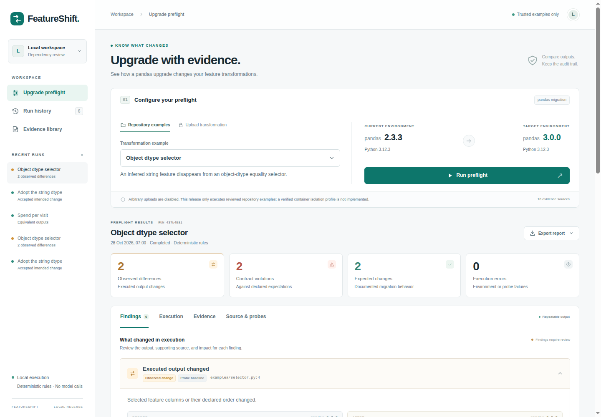

# FeatureShift

FeatureShift helps an ML/platform engineer review a pandas dependency upgrade.
It executes a reviewed feature transformation with identical input under **pandas
2.3.3 and 3.0.0**, compares outputs against an explicit contract, and attaches
versioned documentation to explain observed changes. It produces an audit record,
reviewable probe code, an HTML/JSON report and a standalone regression test.

This is a local engineering demonstration, not a universal safe-upgrade check or
a commercially validated product. The default provider is deterministic rules:
**no model calls, credentials, cloud services or GPU**.



## Run the local demo

The supported checkout workflow requires Linux x86_64 and Python 3.12; the
verified versions are Python 3.12.3 and uv 0.11.28. Install uv using its
[installation guide](https://docs.astral.sh/uv/getting-started/installation/)
(or `pipx install uv==0.11.28` if you already use pipx). Then:

```sh
git clone https://github.com/ah682/featureshift.git
cd featureshift
make demo
```

Open **http://127.0.0.1:8765**. Setup installs hash-pinned application dependencies
and two separate environments, seeds three real reports, and starts the local UI.
Initial setup needs package access; subsequent execution and evidence retrieval
work offline. Cached wheels support `scripts/setup_environments.py --offline`.
The optional `npm run dev` launcher runs the same demo when Node is available.

Variables in `.env.example` are optional process environment variables; `.env`
files are not loaded automatically. A requested provider other than
`deterministic-rules` is explicitly rejected.

Run `make setup` to install without starting the UI. This release runs from the
source checkout; it is not distributed as a standalone Python wheel.

The main example selects features with `df.dtypes == "object"`. Its `segment`
feature appears before the upgrade and disappears afterward. In contrast,
`select_dtypes(include=["object"])` still retains strings in this **exact** pandas
3.0.0 environment; the suite includes that behavior as a control.

The UI also includes an unchanged numeric transformation and a reviewed adoption
of the string dtype. Choose a case, run it, inspect findings and their evidence,
then accept intended changes with a reason. Acceptance preserves the observation
and adds an audit event. A suggested patch is downloaded/reviewed, never applied.

## CLI and checks

```sh
.venv/bin/python -m featureshift cases
.venv/bin/python -m featureshift run selector
.venv/bin/python -m featureshift run numeric
.venv/bin/python -m featureshift run astype-null
.venv/bin/python -m featureshift run install-failure
.venv/bin/python -m featureshift run stochastic
.venv/bin/python -m featureshift evidence 'dtype object string check'
.venv/bin/python -m featureshift doctor
make check
make test
make evaluate
```

`run` prints the saved HTML path and a summary. `--output /path/to/report` exports
the three artifacts; `--json` emits the full record. `--contract-json '{...}'`
overrides comparison rules and expected output. `--fail-on-contract` exits 2 when
the declared contract is violated; by default, observed changes do not make the
CLI fail. An orchestration failure exits 1. Reports with partial execution explicitly
show the error and cannot imply equivalence.

`make evaluate` writes machine-readable results and readable reports under
`.featureshift/evaluation/`. `make test-fast` runs checks that do not require the
target environments. [CI](https://github.com/ah682/featureshift/actions/workflows/ci.yml)
runs the full suite, evaluation, evidence-integrity checks and browser workflows.
A separate workflow checks dependency advisories. The
[October maintenance audit](docs/QUALITY_AUDIT.md) records fixes and verification limits.

To replay a downloaded regression test, use either target interpreter:

```sh
.featureshift/envs/before/bin/python /path/to/regression_test.py
.featureshift/envs/after/bin/python /path/to/regression_test.py
```

The selector artifact passes on the old environment and fails on the new one.
It captures the pre-upgrade behavior; review intentional changes before using it
as a permanent test. It needs only pandas/NumPy and also supports pytest collection.

Stop the server before `make reset`. Reset clears generated reports, review audit,
and evaluation state while retaining environments, wheel cache and evidence. Run
`make seed` to regenerate the three demo cases, or `make demo` to seed and serve.

## Scope and evidence

- Exact shared dependencies: NumPy 2.2.6, python-dateutil 2.9.0.post0, pytz 2025.2,
  tzdata 2025.2 and six 1.17.0. PyArrow is absent in both environments. Resolved
  manifests and installation attempts are captured in `.featureshift/setup/`.
- Repository-owned Python transformations, JSON fixtures, optional contracts and
  existing tests. The registry explicitly chooses source, entry point and fixture.
  Arbitrary uploads and repository execution are disabled: subprocess limits do
  **not** constitute a secure sandbox. No verified container profile exists yet.
- Ten licensed snapshots from immutable official release commits, 23 indexed
  passages, exact-version filters, hashes, passage offsets and publication cutoffs.
  Current documentation is never silently cited as historical evidence.
- Twenty-eight labeled diagnostic cases, including four adapted historical
  regression inputs and a temporal-cutoff control. Scores describe this small
  reviewed suite, not generalization to customer repositories.
- No embedding retrieval, live model provider, external coding-assistant benchmark,
  automatic deployment or autonomous migration. These profiles are unavailable.

Read [the walkthrough](docs/DEMO.md), [architecture](docs/ARCHITECTURE.md),
[data provenance](docs/DATA.md), [evaluation](docs/EVALUATION.md),
[verification](docs/VERIFICATION.md) and [limitations](docs/LIMITATIONS.md).

Project code is [MIT licensed](LICENSE). Cached pandas sources and adapted
regression inputs retain the [upstream notices](evidence/licenses/).
